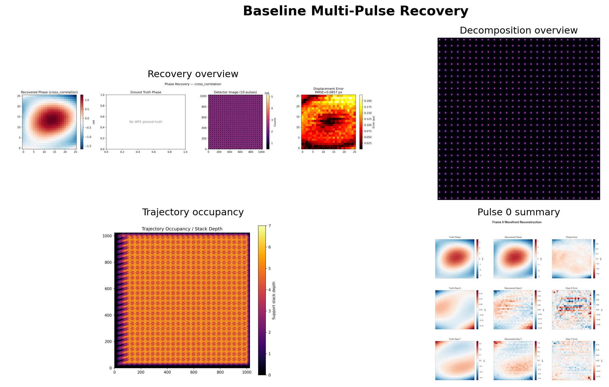
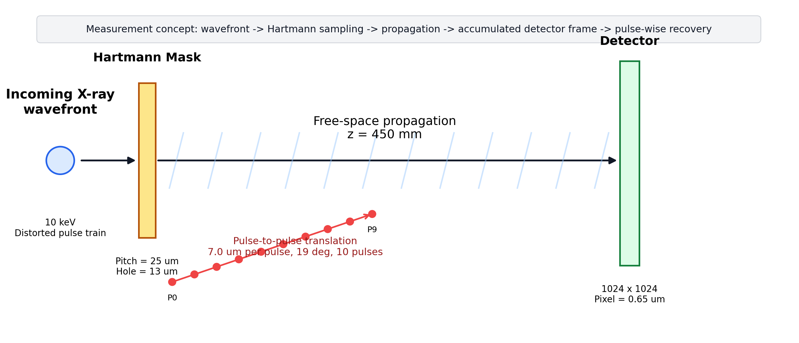
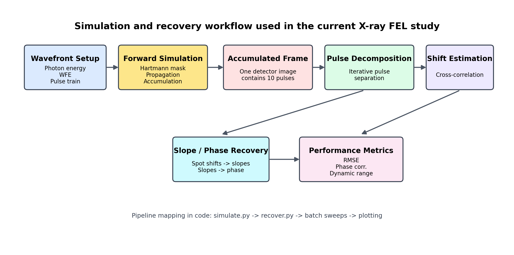
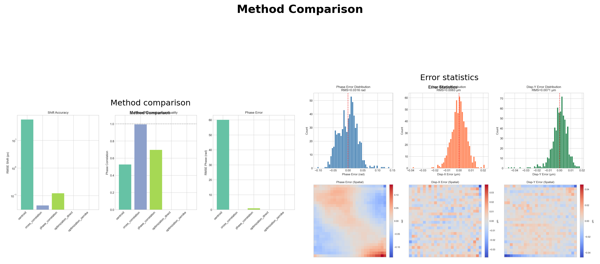
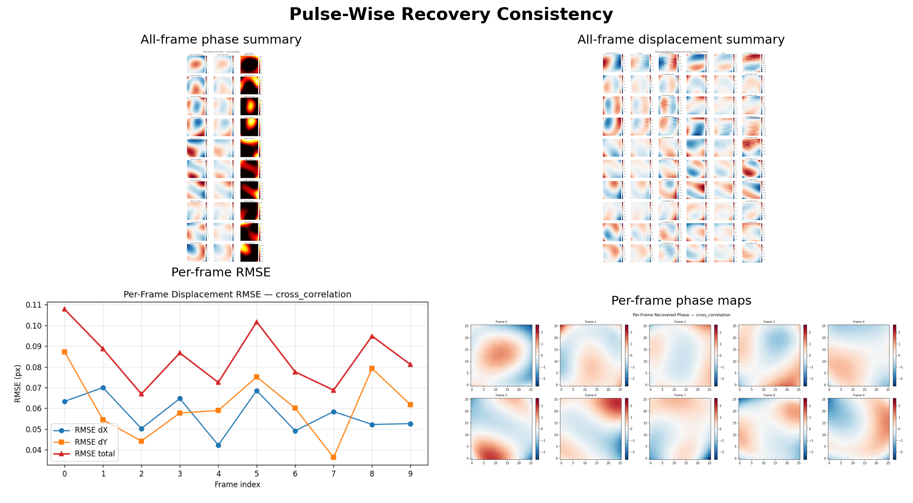

# Motivation

- High-repetition-rate FEL can produce multiple X-ray pulses within one detector integration window.
- A conventional Hartmann workflow expects one wavefront per frame, but here one frame may contain many pulses.
- The core problem is to recover pulse-wise wavefronts from one accumulated detector image.

{width=88%}

# Research Objective

- Simulate accumulated multi-pulse X-ray Hartmann measurements.
- Decompose one accumulated frame into pulse-wise spot fields.
- Recover local spot displacements and reconstruct pulse-wise wavefront phase.
- Evaluate accuracy, robustness, and operating limits.

# Optical Design

- Incoming distorted X-ray wavefront is sampled by a Hartmann mask and then propagated to the detector.
- Baseline geometry: `10 keV`, `z = 450 mm`, `pitch = 25 um`, `hole = 13 um`.
- The detector integrates `10` translated pulses into a single accumulated image.

{width=92%}

# Experimental Workflow

- Forward model: wavefront setup -> Hartmann propagation -> detector accumulation.
- Inverse model: decomposition -> cross-correlation shift estimation -> slope integration -> phase reconstruction.
- Code path: `simulate.py` -> `recover.py` -> sweep scripts -> plotting.

{width=92%}

# Recovery Algorithm

1. Generate or load an accumulated detector frame.
2. Decompose the frame into pulse-wise spot components.
3. Estimate local shifts with cross-correlation.
4. Convert shifts to slopes and integrate to phase.
5. Compare against oracle and pulse-wise reference metrics.

- Main recovery method: `cross_correlation`
- Decomposition: `iterative`
- Patch half-size: `13`
- Reference mode: `per_pulse`

{width=88%}

# Baseline Experimental Configuration

- Propagation distance: `450 mm`
- Pulse-to-pulse step: `7 um`
- Translation angle: `19 deg`
- Number of pulses: `10`
- Sub-aperture grid: `26 x 26`
- Fresnel number: `0.757`
- Detector pixel size: `0.65 um`

# Baseline Result: Decomposition and Recovery

- The baseline case successfully decomposes one accumulated frame into pulse-wise spot maps.
- Mean decomposition confidence: `0.9978`
- Oracle per-frame shift RMSE: `0.0468 px`
- Cross-correlation remains stable over all `10` pulses.

{width=88%}

# Baseline Result: Pulse-Wise Phase and Displacement

- The recovery is consistent across all pulses rather than relying on one best frame.
- Average cross-correlation shift RMSE: `0.0441 px`
- Average cross-correlation phase RMSE: `0.1111 rad`
- Average phase correlation: `0.9937`

{width=88%}

# Method Comparison

- `cross_correlation` is the only reliable primary method in the current pipeline.
- `centroid` fails badly under the multi-pulse accumulated condition.
- `phase_correlation` remains usable as a comparison baseline, but is clearly weaker.

| Method | Avg. shift RMSE (px) | Avg. phase RMSE (rad) | Avg. phase corr. |
|---|---:|---:|---:|
| Centroid | 56.9241 | 60.1476 | 0.5275 |
| Cross-correlation | 0.0441 | 0.1111 | 0.9937 |
| Phase correlation | 0.1214 | 0.9730 | 0.6965 |

{width=78%}

# Physical Performance and Limits

- Displacement resolution: `28.66 nm`
- Angular resolution: `0.06368 urad`
- Conservative `3sigma` displacement resolution: `85.97 nm`
- Minimum measurable phase-gradient scale: `3227.03 rad/m`
- Dynamic range: `436:1`
- Highest measurable spatial frequency: `20000.0 m^-1`
- Minimum resolvable period: `50 um`

# Parameter Sweep Design

- Three parameter sweeps were used to map the operating envelope.
- `STEP_M`: `7.0 -> 10.0 um`, interval `0.5 um`
- `Z_PROP_M`: `450 -> 1000 mm`, interval `50 mm`
- `WFE`: `1 -> 5 rad`
- `N_PULSES = 10` was fixed in all sweep runs.

{width=82%}

# Sweep Result I: STEP Dependence

- Stable operating region is around `7.0 - 8.0 um`.
- Best shift RMSE appears at `STEP_M = 7.0 um`.
- Best phase RMSE appears at `STEP_M = 8.0 um`.
- Performance degrades noticeably for `STEP_M >= 9.5 um`.

{width=88%}

# Sweep Result II: Propagation Distance Dependence

- Best shift RMSE appears near `Z = 500 mm`.
- Best phase RMSE appears near `Z = 450 mm`.
- Performance degrades strongly beyond `700 mm`.
- This is the expected sensitivity vs. dynamic-range trade-off.

{width=88%}

# Sweep Result III: Wavefront Error Dependence

- Best overall accuracy appears at `WFE = 1.0 rad`.
- Shift and phase RMSE increase as aberration strength grows.
- The algorithm remains usable across the tested `1 - 5 rad` range.

{width=88%}

# Recommended Operating Point

- `N_PULSES = 10`
- `STEP_M = 7.0 um`
- `Z_PROP_M = 450 mm`
- `WFE = 3.0 rad` as a representative medium-aberration benchmark
- Recovery method: `cross_correlation`
- Decomposition method: `iterative`

- The current pipeline already achieves nanometer-scale displacement sensitivity on accumulated multi-pulse X-ray Hartmann data.

{width=75%}

# Conclusion

- The current X-ray Hartmann workflow successfully recovers pulse-wise wavefront information from a single accumulated detector frame.
- Cross-correlation is the strongest recovery method in the present implementation.
- The present geometry works best near `450 - 500 mm`.
- The system already reaches high displacement sensitivity while preserving practical dynamic range.

